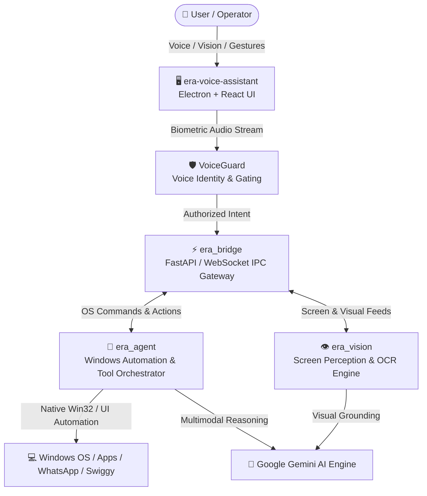

# 🌌 ERA — Next-Generation Multimodal AI Voice & OS Assistant

[](https://github.com)
[](https://reactjs.org/)
[](https://fastapi.tiangolo.com/)
[](https://aistudio.google.com/)
[](#voiceguard-security)

**ERA** is an advanced, privacy-first, fully multimodal autonomous AI desktop assistant. It seamlessly combines **real-time bi-directional voice interaction**, **computer vision & screen perception**, **native Windows operating system automation**, and **intelligent application orchestration**.

---

## 🏛️ System Architecture

ERA operates as a coordinated multi-service ecosystem connected via ultra-low-latency WebSockets and local REST endpoints.



---

## 📂 Repository Structure

This monorepo consolidates all ERA subsystems into a clean, modular structure:

```
ERA/
├── era-voice-assistant/      # 🎙️ Electron & React desktop UI, VoiceGuard, Live Audio
│   ├── src/                  # React UI components, visualizers, state management
│   ├── electron/             # Electron main process & IPC handlers
│   ├── server/               # WebSocket & local server orchestrator
│   └── package.json          # Node.js dependencies
│
├── era_agent/                # 🤖 Autonomous OS controller & tool execution engine
│   ├── commands/             # Native Windows commands, window manager, app controls
│   ├── controls/             # Keyboard, mouse, audio, display, & peripheral controls
│   ├── intelligence_core/    # Context engine, goal interpreter, orchestrator
│   ├── gestures/             # Hand gesture recognition & HUD overlay
│   ├── api_server.py         # FastAPI agent backend (Port 8000)
│   └── requirements.txt      # Python dependencies
│
├── era_bridge/               # ⚡ High-speed local IPC Gateway & Message Router
│   ├── api/                  # REST & WebSocket endpoints
│   ├── core/                 # Session engine, auth boundary, secure store
│   ├── bridge_server.py      # Core bridge server
│   └── requirements.txt      # Python dependencies
│
├── era_vision/               # 👁️ Real-time screen streamer & visual reasoning
│   ├── api/                  # Vision REST API & frame streamer
│   ├── vision/               # Screen capture, OCR engines, fallback pipelines
│   ├── security/             # Visual auth & privacy redaction
│   └── requirements.txt      # Python dependencies
│
├── .gitignore                # Production-grade gitignore (excludes secrets/node_modules/venv)
├── .env.example              # Central configuration template
├── start-era.bat             # 1-Click Windows Batch launcher
└── start-era.ps1             # 1-Click PowerShell launcher
```

---

## 🌟 Core Features

### 1. 🎙️ ERA Voice Assistant (`era-voice-assistant`)
* **Real-time Live Audio Streaming**: Full-duplex conversational voice interaction with ultra-low latency.
* **VoiceGuard Biometric Defense**: Voiceprint enrollment and real-time acoustic gating ensuring only authorized owners can issue high-risk commands.
* **Futuristic HUD & Visualizer**: Circular reactive audio waveform and real-time telemetry.

### 2. 🤖 Autonomous OS Agent (`era_agent`)
* **Native Windows Automation**: Window snapping, app launching, native typing, volume/brightness control, media keys.
* **Specialized Autonomous Modules**:
  * **WhatsApp Adapter**: Automated search, contact messaging, and inbox navigation.
  * **Food Delivery Agent**: Autonomous Swiggy order processing and restaurant cart automation.
  * **Gesture Control**: MediaPipe-powered real-time camera gesture recognition for touchless control.

### 3. ⚡ Local Bridge Gateway (`era_bridge`)
* Centralized message bus providing authenticated, decoupled communication between the Electron frontend, Agent, and Vision engine.
* Session engine with atomic state management and audit logging.

### 4. 👁️ Screen Perception & Vision (`era_vision`)
* Ultra-fast frame capture with dynamic DPI scaling and multi-monitor support.
* Integrated OCR and element detection to locate buttons, text inputs, and UI states.

---

## 🚀 Getting Started

### Prerequisites
* **Windows 10/11 (64-bit)**
* **Python 3.10+** (Added to PATH)
* **Node.js 18+ & npm**
* **Google Gemini API Key** (Get one free from [Google AI Studio](https://aistudio.google.com/))

---

### Step 1: Clone Repository
```bash
git clone https://github.com/your-username/era.git
cd era
```

### Step 2: Environment Setup
Copy the template and configure your API key:
```bash
cp .env.example .env
```
Open `.env` and set:
```env
GEMINI_API_KEY=your_actual_gemini_api_key_here
```

### Step 3: Install Dependencies

#### 1. Frontend & Desktop App
```bash
cd era-voice-assistant
npm install
cd ..
```

#### 2. Python Microservices (`era_agent`, `era_bridge`, `era_vision`)
Create and activate a virtual environment:
```bash
python -m venv venv
venv\Scripts\activate

# Install requirements for each service
pip install -r era_agent/requirements.txt
pip install -r era_bridge/requirements.txt
pip install -r era_vision/requirements.txt
```

---

## 🎮 Running ERA

### Method A: 1-Click Launch (Recommended)
Simply double-click or run:
```cmd
start-era.bat
```
*(Or use PowerShell: `.\start-era.ps1`)*

This script will start all 4 services concurrently in separate consoles:
1. `era_agent` on `http://127.0.0.1:8000`
2. `era_bridge` on `http://127.0.0.1:8765`
3. `era_vision` on `http://127.0.0.1:8766`
4. `era-voice-assistant` Electron Desktop App

### Method B: Manual Service Startup
Run each service in its own terminal window:

```bash
# Terminal 1: Agent
cd era_agent
python api_server.py

# Terminal 2: Bridge
cd era_bridge
python main.py

# Terminal 3: Vision
cd era_vision
python main.py

# Terminal 4: Frontend
cd era-voice-assistant
npm run dev
```

---

## 🔒 Security & Privacy

* **Zero Cloud Data Leakage**: Sensitive configuration (`credentials.json`, `token.json`, WhatsApp databases, session keys) are excluded by `.gitignore` and never committed.
* **VoiceGuard Gating**: Critical system calls (like deleting files, sending messages, or placing orders) require verified owner voiceprint authorization.

---

## 🤝 Contributing
Contributions are welcome! Please open an issue or submit a Pull Request.

---

## 📄 License
This project is licensed under the MIT License — see the LICENSE file for details.
