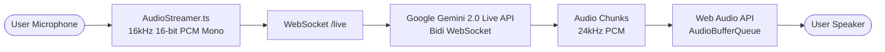
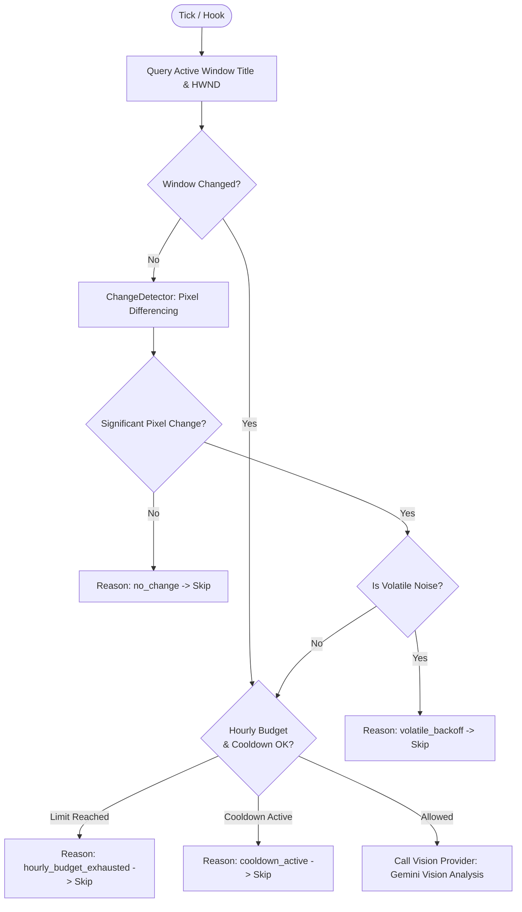
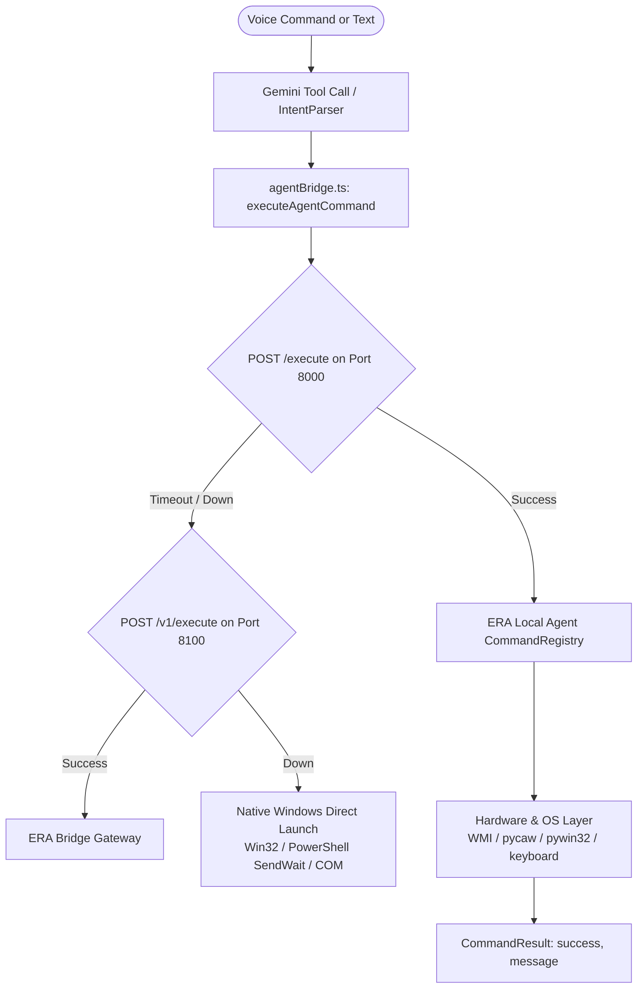
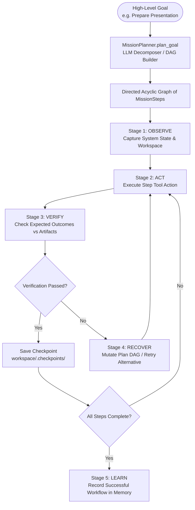
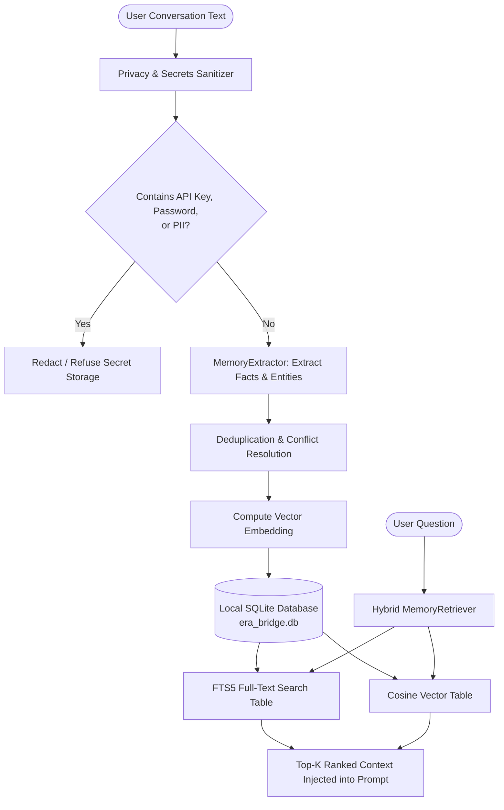

# ERA AI — Pipeline Documentation

This document describes the six core runtime pipelines that power ERA AI. Each pipeline specification details inputs, processing stages, outputs, timeout and error handling, and recovery mechanisms.

---

## 1. Voice & Live Multimodal Audio Pipeline



- **Input:** Raw microphone audio stream via Web Audio API `AudioWorkletNode` or `ScriptProcessorNode`.
- **Processing Stages:**
  1. Downsampling to 16,000 Hz, single channel (mono), 16-bit linear PCM format.
  2. Base64 encoding into chunks transmitted every 100ms via WebSocket (`/live`).
  3. Forwarding by Express server to Google Gemini Multimodal Live API over secure WebSocket.
  4. Receiving Gemini synthetic voice stream (24kHz PCM chunks).
  5. Enqueueing in `AudioStreamer.playAudioChunk()` using an audio queue with gapless scheduling to avoid stutter.
- **Output:** Immediate, conversational natural-sounding speech response.
- **Error & Recovery:**
  - If WebSocket disconnects, exponential backoff reconnects within 2 seconds.
  - Wake-word detection state machine shifts to `idle` upon disconnection and reactivates cleanly upon reconnection.
  - Mic muted flag cleanly halts recording without resetting the conversation session.

---

## 2. Physical Desktop Screen Capture & Streamer Pipeline

```mermaid
flowchart LR
    Desktop([Windows Desktop]) --> GDI[Win32 GDI BitBlt<br/>GetDC / CreateCompatibleDC]
    GDI --> Resize[Resize to 1280x720<br/>JPEG Quality 60 (~35KB)]
    Resize --> HTTP[POST http://127.0.0.1:3000/api/screen/upload]
    HTTP --> Cache[currentPhysicalScreenBase64]
    Cache --> GeminiStream[Injected into Gemini Live Video Feed<br/>Rate: 1 FPS]
```

- **Input:** Windows interactive desktop framebuffer (`\\.\DISPLAY1`).
- **Processing Stages:**
  1. `server/desktop_screen_streamer.py` connects to the interactive Windows desktop window station using `OpenInputDesktop` and `SetThreadDesktop`.
  2. Captures full virtual screen coordinates using GDI `BitBlt` and copies bitmap data via `GetDIBits`.
  3. Resizes image to 1280x720, compresses with JPEG quality 60 (keeping frame size ~35KB).
  4. Submits payload via HTTP POST to `http://127.0.0.1:3000/api/screen/upload`.
  5. Node.js server updates `currentPhysicalScreenBase64` and injects frames into the active Gemini Live WebSocket connection.
- **Output:** Visual context enabling the model to see active applications, code, terminal outputs, and chats.
- **Timeout & Error Handling:**
  - Target rate: 1.0 frame per second (designed for Gemini Live rate limits).
  - Timeout: 2.0s per upload; transient network drops do not crash the streamer loop.
  - If locked desktop or UAC prompt is displayed, GDI BitBlt gracefully logs a warning and retries on the next tick.

---

## 3. Vision Policy & Rate-Budgeted Perception Pipeline



- **Input:** Window focus events and screen frame buffers.
- **Processing Stages:**
  1. `AnalysisPolicy.decide()` enforces budget and cooldown guards.
  2. Active window switches trigger immediate analysis if budget allows.
  3. `ChangeDetector` computes pixel diff percentage and generates a tight bounding box around the altered screen quadrant.
  4. Volatility damping suppresses rapid video playback or animated GIF noise (`volatile_backoff`).
  5. Selected frames pass to `Analyzer` for semantic classification (error dialog, chat message, code error, chart).
- **Output:** Structured `ScreenState` observation cached in `ContextManager` rolling history window (default capacity: 50 observations, 300s TTL).
- **Safety Policy:**
  - Hard cap: 3,600 calls/hour maximum.
  - Cooldown: Enforces minimum time between automatic pixel-difference analyses.

---

## 4. Command Processing & Hardware Control Pipeline



- **Input:** Intent JSON from Gemini Live or natural-language query string.
- **Processing Stages:**
  1. `agentBridge.ts` standardizes command aliases (e.g. `openApp` $\to$ `open_app`).
  2. Dispatches HTTP POST to `http://127.0.0.1:8000/execute` with timeout 2,500ms.
  3. `CommandRegistry` maps command name, validates parameters against schema, and dispatches to appropriate module:
     - `controls.display`: WMI brightness queries and adjustments.
     - `controls.audio`: Windows CoreAudio API (`IAudioEndpointVolume`) for precision volume and muting.
     - `controls.keyboard`: OEM WMI backlight control (MSI SteelSeries, ASUS ROG WMI, Dell Alienware, Lenovo Legion).
     - `commands.system_commands`: Application launching via Start Menu shortcut index, file exploration, power management.
- **Output:** JSON `CommandResult` (`success: boolean, message: string, output?: string`).
- **Resilience Guarantee:**
  - If Port 8000 is unavailable, Bridge Gateway on Port 8100 is invoked.
  - If both servers are offline, `agentBridge.ts` falls back to direct PowerShell / Win32 API execution, ensuring fundamental system commands (typing, shortcuts, app launch) never fail.

---

## 5. Autonomous Mission & Outcome Planning Pipeline



- **Input:** High-level natural-language goal (e.g., "Create a personal portfolio website with a game").
- **Processing Stages:**
  1. **Plan Generation:** `MissionPlanner` queries Gemini (or fallback template engine) to decompose the goal into atomic `MissionStep` objects with prerequisites, risk levels, and timeout bounds.
  2. **Risk & Authorization Inspection:** Actions categorized by `RiskLevel` (`LOW`, `MEDIUM`, `HIGH`, `CRITICAL`). Sensitive actions request explicit user authorization.
  3. **Act & Verify:** `ERAMissionEngine` executes actions in topological order. Post-execution hooks inspect created files, processes, or command outputs.
  4. **Dynamic Recovery:** If a step fails (e.g. missing package or syntax error), `OutcomeEngine` analyzes the traceback, installs missing dependencies or patches code, and resumes execution.
- **Output:** Executed task artifact, verified working application, and completed mission record.

---

## 6. Semantic Memory & Retrieval Pipeline



- **Input:** User conversational input or explicitly stated preference.
- **Processing Stages:**
  1. **Sanitization:** Strict privacy filters reject API keys, OAuth tokens, credit cards, health records, and government IDs.
  2. **Extraction:** Facts, preferences, project states, and constraints extracted into categorized `Memory` records (`PREFERENCE`, `FACT`, `PROJECT_STATUS`, `WORKFLOW`).
  3. **Conflict Resolution:** Newer statements supersede older facts; slot-less updates replace related older records without manual schema migration.
  4. **Indexing:** Record is stored in SQLite table and indexed both via SQLite FTS5 (for exact keyword/name lookup) and high-dimensional vector embeddings (for semantic similarity).
  5. **Retrieval:** During conversation, `MemoryRetriever` performs hybrid search (FTS5 + vector cosine distance) and injects only the top-K relevant facts into the active context window.
- **Output:** Personalized, continuity-preserving context without leaking confidential credentials.
