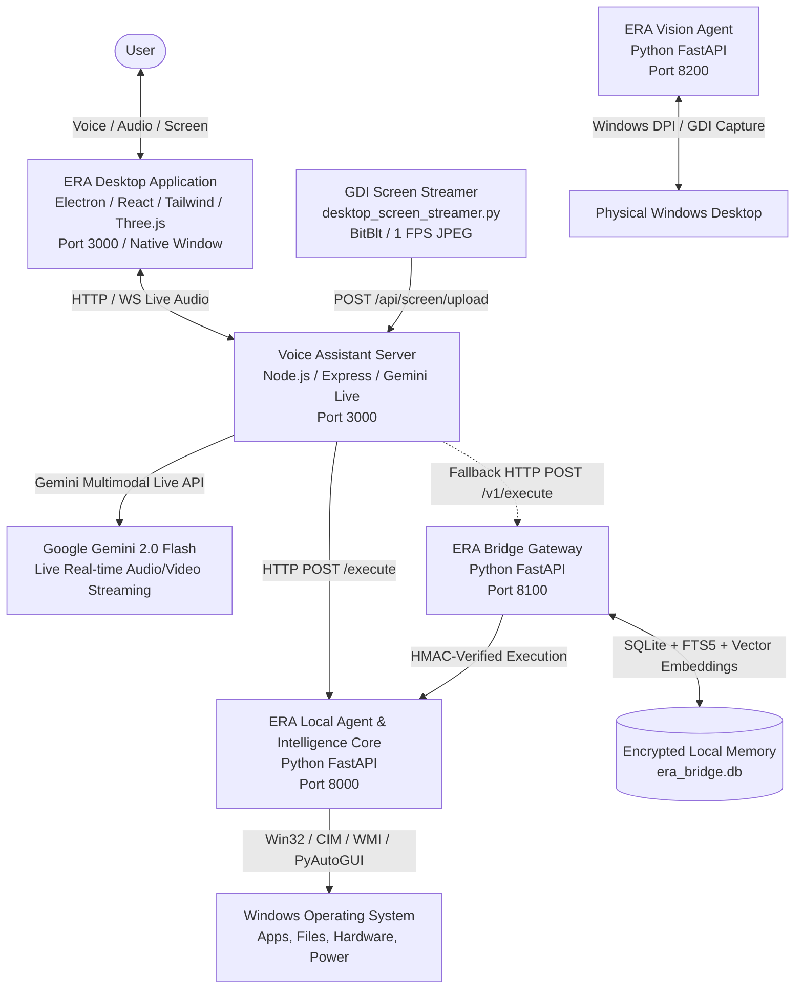
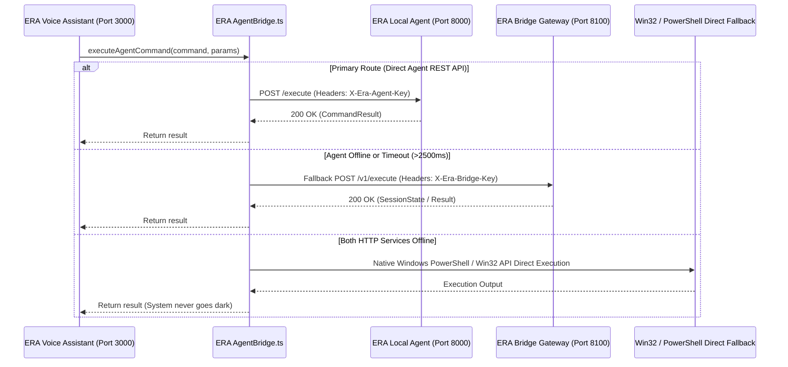

# ERA AI — Unified System Architecture Specification

## 1. Executive Summary & Architectural Overview

ERA AI is a local-first, low-latency, multimodal personal computer intelligence system. It combines real-time bidirectional voice communication, live visual screen awareness, OS-level hardware/software automation, autonomous multi-step outcome planning, and encrypted local semantic memory.

The system is organized into decoupled microservices communicating over local loopback (`127.0.0.1`) REST, WebSockets, and inter-process signals.

---

## 2. Service Topology and Port Allocations

| Service Name | Working Directory | Runtime / Process | Port | Health / Status Endpoint | Primary Responsibility |
|---|---|---|---|---|---|
| **ERA Local Agent & Intelligence Core** | `d:\era_agent` | Python 3.14 (FastAPI / Uvicorn) | **8000** | `http://127.0.0.1:8000/status` | OS hardware controls, display, audio, volume, power, file system, Autonomous Mission & Outcome Engines. |
| **ERA Bridge Gateway** | `d:\era_bridge\era_bridge` | Python 3.14 (FastAPI / Uvicorn) | **8100** | `http://127.0.0.1:8100/health` | Memory management (SQLite/FTS5/vectors), session state, telemetry, and lease authorization. |
| **ERA Vision Agent** | `d:\era_vision\era_vision_agent_phase2\era_vision_agent` | Python 3.14 (FastAPI / Uvicorn) | **8200** | `http://127.0.0.1:8200/health` | Active-window tracking, bounding-box change detection, rate-budgeted visual reasoning. |
| **ERA Voice Assistant & UI Server** | `d:\era-voice-assistant` | Node.js (Express / Vite / TSX) | **3000** | `http://127.0.0.1:3000/api/health` | Audio streaming, WebSockets (`/live`), Gemini Live API bridge, React UI dashboard. |
| **Desktop Screen Streamer** | `d:\era-voice-assistant\server` | Python background daemon | *Streamer* | Internal loop | 1 FPS real-time physical screen capture via GDI BitBlt streamed to `/api/screen/upload`. |

---

## 3. Logical Architectural Boundaries

### 3.1 Core Engine & Command Registry
- Located in: `d:\era_agent\commands` and `d:\era_agent\era_agent\commands`.
- Implements `CommandRegistry` with parameterized command schemas (`CommandParam`, `CommandResult`).
- Exposes 52 verified OS-level automation commands:
  - **Display Controls:** `get_display_brightness`, `set_display_brightness`, `adjust_display_brightness`, `set_brightness`.
  - **Audio Controls:** `get_audio_volume`, `set_audio_volume`, `adjust_audio_volume`, `toggle_audio_mute`.
  - **Power & System:** `lock_pc`, `shutdown_pc`, `restart_pc`, `cancel_shutdown`.
  - **Peripherals & Backlight:** `get_peripheral_status`, `set_bluetooth_state`, `set_wifi_state`, `get_keyboard_backlight`, `set_keyboard_backlight`, `adjust_keyboard_backlight`.
  - **App & Window Automation:** `open_app`, `open_browser`, `open_chrome`, `open_notepad`, `open_calculator`, `open_camera`, `open_file_explorer`, `open_file`, `search_file`, `focus_window`.
  - **Direct Input Control:** `click_screen`, `scroll_screen`, `type_text`, `press_key_combination`.
  - **Background Controller:** `list_background_apps`, `get_background_activity`, `capture_background_window`, `inspect_background_window`, `background_click`, `background_type`, `background_send_keys`, `background_close_window`.
  - **Communications:** `open_whatsapp`, `send_whatsapp_message`, `send_whatsapp_to_multiple`, Phone Link integrations.

### 3.2 Voice Processing Pipeline
- Located in: `d:\era-voice-assistant\src` and `d:\era-voice-assistant\server`.
- Audio capture via `AudioStreamer.ts` (PCM 16-bit, 16kHz mono).
- WebSocket connection to Express server (`/live`).
- Direct duplex streaming to Google Gemini 2.0 Multimodal Live API.
- Incoming audio chunks buffered and played through Web Audio API Context (`audio/pcm;rate=24000`).
- Wake-word detection engine with state machine (`idle`, `listening`, `detected`, `unsupported`, `permission_denied`, `muted`, `disabled`).

### 3.3 Vision & Screen Awareness Layer
- Primary stream: `server/desktop_screen_streamer.py` captures 1280x720 JPEG frames (quality 60, ~35KB) at 1 FPS via Windows GDI (`GetDC`, `CreateCompatibleDC`, `BitBlt`, `GetDIBits`).
- Frames uploaded to `POST /api/screen/upload` and piped dynamically into Gemini Live session.
- Secondary vision intelligence: `ERA Vision Agent` (Port 8200) monitors window focus switches, detects bounding-box pixel mutations with volatility damping, and applies rate-limiting policies (`AnalysisPolicy`).

### 3.4 Autonomous Agent & Outcome Engine
- Located in: `d:\era_agent\era_agent\outcome_engine` and `d:\era_agent\era_agent\mission_engine`.
- Implements the complete loop:
  $$\text{OBSERVE} \longrightarrow \text{UNDERSTAND} \longrightarrow \text{PLAN} \longrightarrow \text{ACT} \longrightarrow \text{VERIFY} \longrightarrow \text{RECOVER} \longrightarrow \text{LEARN}$$
- Generates DAG execution graphs from natural-language instructions.
- Checkpoints progress in `workspace/.checkpoints/` for pause, resume, and failure recovery.
- Tool registry dynamically verifies precondition tools and executes file creations, edits, commands, and communication adapters.

### 3.5 Memory Management Layer
- Located in: `d:\era_bridge\era_bridge\era_memory`.
- Persists to local SQLite database: `era_bridge.db`.
- Schema features:
  - Full-Text Search (SQLite FTS5 virtual table).
  - High-dimensional vector embeddings with cosine similarity.
  - Automatic memory extraction, deduplication, and slot-less user corrections.
  - Strict privacy filter: refuses API keys, passwords, credit cards, health records, and Aadhaar numbers.

### 3.6 API & Bridge Gateway Layer
- Located in: `d:\era_bridge\era_bridge`.
- Protects local agent with shared secret authentication (`X-Era-Bridge-Key`, `X-Era-Agent-Key`).
- Enforces session states, parameter collection for Class 2 commands, and user confirmation gates for sensitive actions (e.g., system shutdown).

---

## 4. High-Availability Execution Flow & Fallback Architecture

---

## 5. Security & Privacy Guarantees

1. **Local-First Boundary:** All process orchestration, computer perception, and automation scripts run strictly on loopback interfaces (`127.0.0.1` / `localhost`). External interfaces are never bound.
2. **Zero Telemetry Leakage:** Hardware telemetry (CPU, RAM, GPU, Battery) is inspected locally using `psutil`, `GPUtil`, and `wmi`. No screen frames or file contents are shared beyond the user's configured Gemini API key endpoint.
3. **Sensitive Data Redaction:** API keys, passwords, bearer tokens, and government IDs are rejected at the memory ingestion gateway before touching SQLite disks.
4. **Authorization Bounds:** Local Agent supports `agent_security.py` with HMAC-SHA256 authorization lease tokens for enterprise environments, while supporting seamless local-token operation in standalone desktop mode.
